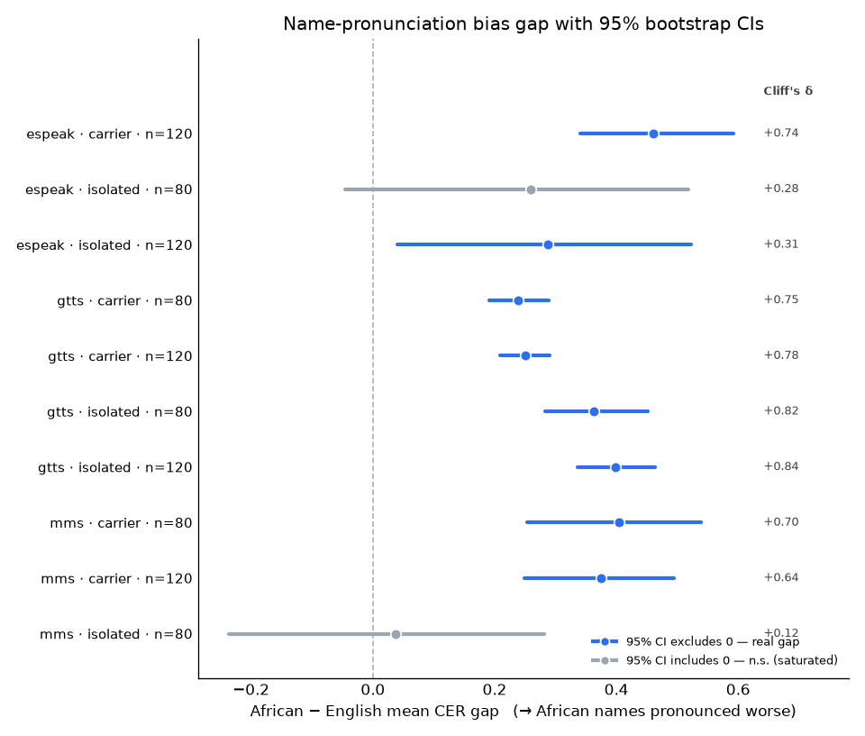

# Master results

Every scored run, side by side. Lower CER = better; the **gap** (African − English mean CER) is the bias signal. Generated by `aggregate_results.py`.

The same results as a figure — each run's gap with its 95% bootstrap CI (`forest_plot.py`); intervals clear of zero are real gaps, the two that cross zero are the saturated isolated-word baselines:

| engine | condition | n | English CER | African CER | gap | gap 95% CI | Cliff's δ | p |
|--------|-----------|--:|------------:|------------:|----:|-----------|----------|---|
| espeak | carrier | 120 | 0.13 | 0.59 | **+0.46** | [0.34, 0.59] | +0.74 (large) | 6.4e-10 |
| espeak | isolated | 80 | 0.64 | 0.90 | **+0.26** | [-0.05, 0.52] | +0.28 (small) | 3.0e-02 |
| espeak | isolated | 120 | 0.59 | 0.88 | **+0.29** | [0.04, 0.52] | +0.31 (small) | 5.4e-03 |
| gtts | carrier | 80 | 0.01 | 0.24 | **+0.24** | [0.19, 0.29] | +0.75 (large) | 9.6e-08 |
| gtts | carrier | 120 | 0.00 | 0.25 | **+0.25** | [0.21, 0.29] | +0.78 (large) | 1.9e-11 |
| gtts | isolated | 80 | 0.01 | 0.37 | **+0.36** | [0.28, 0.45] | +0.82 (large) | 9.2e-09 |
| gtts | isolated | 120 | 0.00 | 0.40 | **+0.40** | [0.34, 0.46] | +0.84 (large) | 1.1e-12 |
| mms | carrier | 80 | 0.21 | 0.61 | **+0.40** | [0.25, 0.54] | +0.70 (large) | 1.5e-06 |
| mms | carrier | 120 | 0.20 | 0.58 | **+0.37** | [0.25, 0.49] | +0.64 (large) | 7.0e-08 |
| mms | isolated | 80 | 0.87 | 0.90 | **+0.04** | [-0.24, 0.28] | +0.12 (negligible) | 2.2e-01 |

Notes: a *clean* English baseline (near 0) makes the gap interpretable; engines whose isolated audio the ASR can't read (espeak, MMS) saturate the metric — compare **within** an engine and prefer the carrier rows. The **gap 95% CI** is a seeded percentile bootstrap (2,000 resamples) of the mean-CER gap; an interval clear of 0 is the interval-based counterpart to a significant test. See [FINDINGS.md](FINDINGS.md) for the significance tests and discussion.
