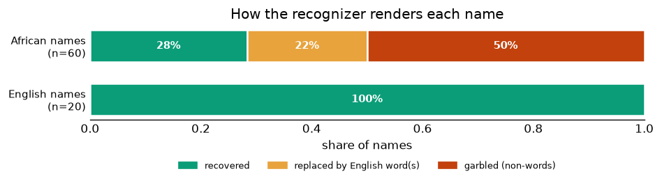

# How names fail: recovered, replaced by English, or garbled

Generated by `error_taxonomy.py` from the committed scores (gTTS isolated, the clean-baseline run). Each name's transcription is sorted into one outcome; “English word” is judged against the ~10k most common English words, so the *replaced by English* rate is a **conservative lower bound**.

| outcome | English | African |
|---------|--------:|--------:|
| recovered | 20 (100%) | 17 (28%) |
| replaced by English word(s) | 0 (0%) | 13 (22%) |
| garbled (non-words) | 0 (0%) | 30 (50%) |
| dropped (empty) | 0 (0%) | 0 (0%) |

- **English names are recovered 100% of the time; African names only 28%.**
- Of the African names that were *not* recovered, at least **30%** were replaced by ordinary English words/phrases rather than a novel approximation.

Examples (African names):

- *recovered:* Temitope → "Tema tope"; Oluwafemi → "Oluwa Femi"; Funmilayo → "Fun Malayo"
- *replaced by English word(s):* Adebayo → "At a bail."; Folake → "For Locker"; Olumide → "All you might."
- *garbled (non-words):* Oluwaseun → "Alois Seyoon"; Babatunde → "Boba Tundee"; Adenike → "Arunike."
